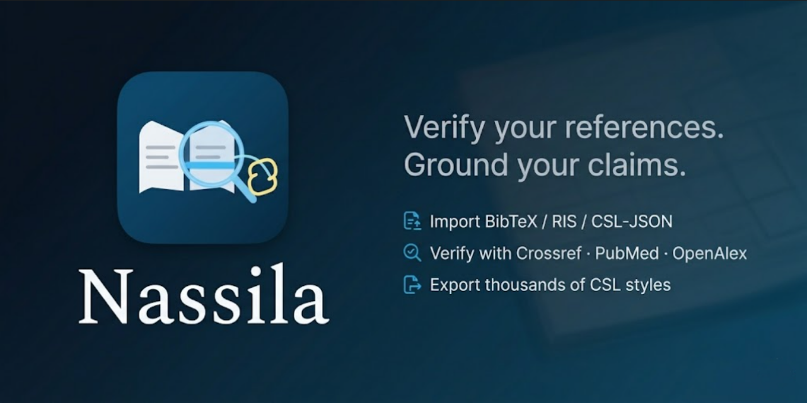

[](https://github.com/jamalesam93/Nassila/releases/latest)

# Nassila

**Nassila** (ناسيلا) is a Windows desktop app that helps you **clean and check a reference list before you submit** — not a full reference manager, but a quality pass on citations you already have.

*Verify your references. Ground your claims.*  
*The last check before you submit — bibliography, registries, and source-backed writing.*

Import or paste your bibliography, fix common errors, verify rows against Crossref / PubMed / OpenAlex, flag predatory journals, remove duplicates, and export in thousands of [CSL](https://citationstyles.org/) styles.

| | |
|---|---|
| **Download (Windows)** | [**v2.1.2**](https://github.com/jamalesam93/Nassila/releases/tag/v2.1.2) · [Latest release](https://github.com/jamalesam93/Nassila/releases/latest) |
| **Sanad model (HF)** | [`nassila-sanad-9b`](https://huggingface.co/QinEmPeRoR93/nassila-sanad-9b) (**FT-6** / v119 — sole tier; 6 default + 6 MTP GGUFs) — setup on the [website](https://nassila-web.vercel.app/en/docs/manuscript) |
| **Website & docs** | [nassila-web.vercel.app](https://nassila-web.vercel.app) — [How-to](https://nassila-web.vercel.app/en/docs/how-to) · [User guide](https://nassila-web.vercel.app/en/docs/user-guide) · [Changelog](https://nassila-web.vercel.app/en/changelog) |
| **Documentation (repo)** | [How-to guide](docs/HOW_TO_GUIDE.md) · [User guide](docs/USER_GUIDE.md) · [Brand](docs/BRAND.md) · [Changelog](CHANGELOG.md) |
| **License** | [MIT](LICENSE) |

> End users: install from **Releases** ([**v2.1.2**](https://github.com/jamalesam93/Nassila/releases/tag/v2.1.2)) or visit the [**website**](https://nassila-web.vercel.app). Developers: clone this repo and see [Getting started](#getting-started).

The name **Nassila** is coined, inspired by the idea of a **sanad** (سند): a clear chain from what you write to where it came from.

## What's new in v2.1.2 — Arabic localization & security hardening

- **Arabic localization & CLDR pluralization:** Comprehensive copy audit across all views and native menus. Replaced English calques with standard academic terminology (e.g. predatory journals as `دوريات ومجلات وهمية / افتراسية`), and added full 6-form CLDR pluralization rules (`zero`, `one`, `two`, `few`, `many`, `other`) for citations and issues.
- **Security hardening & 0 vulnerabilities:** Upgraded Electron to `^42.11.16` (`42.11.18`, eliminating all 14 active CVE advisories), upgraded PDF.js to `^6.2.108` (`6.4.299`), pinned `onnxruntime-node@1.29.0`, and refreshed transitive packages. `npm audit` reports 0 vulnerabilities.
- **PDF.js worker leak prevention:** Systematically wrapped all PDF extraction and OCR document loading tasks with `loadingTask.destroy()` in `finally` cleanup blocks.
- **Zero-dependency icon generator:** Removed `to-ico` and eliminated 85 legacy transitive packages in favor of an inline DIB stream encoder producing a bit-for-bit identical icon.
- **Arabic OCR & L3:** Scanned Arabic PDFs continue to use in-app Indra when weights are downloaded (with packaged Paddle fallback). Sanad Arabic (**2.2.0**) stays paused for budget.

Earlier releases: [CHANGELOG.md](CHANGELOG.md) · [v2.1.2 release](https://github.com/jamalesam93/Nassila/releases/tag/v2.1.2).

## Who is this for?

- Students and researchers preparing a thesis or manuscript reference list  
- Anyone exporting from **Zotero**, **Mendeley**, or **EndNote** who wants validation and registry checks before submission  
- Editors who need a quick **predatory-journal** screen and **duplicate** detection on a batch of references  

## What it does

1. **Import or paste** — BibTeX, RIS, CSL-JSON, plain text, DOCX/PDF reference sections, or manager exports  
2. **Validate** — missing fields and style-specific issues (works offline)  
3. **Autocorrect** — DOI formats, capitalization, page ranges, medRxiv/bioRxiv DOI canonicalization, and more  
4. **Verify references** — one action: resolve each row to Crossref, PubMed, or OpenAlex (**L1**), then compare your metadata to the canonical record (**L2**), with safe auto-patches when registries agree (up to **200** prioritized rows per run)  
5. **Predatory journal scan** — match journal titles against bundled and updatable predatory/pseudo-journal lists  
6. **Deduplicate** and **export** — formatted bibliography in APA, IEEE, Vancouver, Chicago, Harvard, MLA, Nature (bundled), or any style from the [Zotero CSL repository](https://github.com/citation-style-language/styles)  
7. **Manuscript loop (Ouroboros)** — upload or paste a manuscript, verify cited references (L1/L2) with duplicate entries merged, fetch open-access source text, attach source PDFs individually or by scanning a whole folder (matched references re-audited only), and optional **Sanad** passage grounding (L3) — [manuscript guide](https://nassila-web.vercel.app/en/docs/manuscript)

**Privacy:** list editing and validation work offline. Registry verification, DOI lookup, predatory-list sync, and manuscript source fetch use the network only when you run those actions.

## Highlights

| Area | Capability |
|------|------------|
| Parsing | BibTeX, RIS, CSL-JSON, plain text, URL-only webpages, DOCX/PDF reference extraction (PDF uses fast Rust WASM parser with Markdown tables & column layout) |
| Resolution | DOI, ISBN, PMID, URL → Crossref, PubMed, Open Library |
| Verification | Unified L1+L2 registry check (main-process IPC in packaged app), up to 200 rows per run |
| Integrity | Predatory/suspicious journal flags, duplicate groups with merge |
| Manuscript | Ouroboros loop: L1/L2 verify + bibliography dedupe, OA source fetch, per-source PDF attach or folder-scan attach with review, targeted re-audit, optional Sanad L3 ([HF model](https://huggingface.co/QinEmPeRoR93/nassila-sanad-9b)) |
| Output | CSL formatting, undo/redo, dark/light mode, EN/AR UI |

## Getting started

### Prerequisites

- Node.js 20.19+ (Node 22 LTS recommended)
- npm 9+

### Install and run locally

```bash
npm install
npm run dev
```

### Build the Windows installer

```bash
npm run icon:raster   # once: generates build/icon.png
npm run build
npm run build:win     # → dist/Nassila Setup <version>.exe
```

Other targets: `npm run build:mac`, `npm run build:linux`, `npm run build:unpack` (unpacked Windows folder for testing).

### Tests

```bash
npm test
```

## Tech stack

Electron · React 19 · TypeScript · Tailwind · citeproc-js · Zustand · Vitest

## Open-source acknowledgments

Nassila is built on top of incredible open-source tools, libraries, and specifications:

| Project | Role in Nassila | License |
|---------|-----------------|---------|
| [**pdf-inspector**](https://github.com/firecrawl/pdf-inspector) | PDF text layer, layout, and Markdown tables. Born-digital pages are read here before any OCR | MIT |
| [**PaddleOCR**](https://github.com/PaddlePaddle/PaddleOCR) PP-OCRv5 | Packaged Arabic scan OCR. Also the page-level fallback when Indra cannot read a page | Apache-2.0 |
| [**ppu-paddle-ocr**](https://github.com/PT-Perkasa-Pilar-Utama/ppu-paddle-ocr) | Runs the Paddle ONNX models inside the app | MIT |
| [**ONNX Runtime**](https://github.com/microsoft/onnxruntime) | Runs the Paddle and Indra models on this machine | MIT |
| [**OpenCV.js**](https://github.com/TechStark/opencv-js) | Page resize and deskew for the Indra reader | Apache-2.0 |
| [**Indra OCR**](https://github.com/datalab-to/indra-ocr) | Optional Arabic reader. About 14 MB, downloaded from Settings, not shipped in the installer | Modified OpenRAIL-M (weights) |
| [**Tesseract.js**](https://github.com/naptha/tesseract.js) and [tessdata_fast](https://github.com/tesseract-ocr/tessdata_fast) | English and French scan OCR only (`eng`, `fra`). Arabic does not use Tesseract | Apache-2.0 |
| [**PDF.js**](https://github.com/mozilla/pdf.js) | Fallback PDF text and page raster for OCR | Apache-2.0 |
| [**Citation-js**](https://github.com/citation-js/citation-js) | Parsing BibTeX, RIS, and CSL-JSON | MIT |
| [**citeproc-js**](https://github.com/juris-m/citeproc-js) | CSL formatting for APA, IEEE, Vancouver, Chicago, and custom styles | AGPL-2.0 / CPAL-1.0 |
| [**Mammoth**](https://github.com/mwilliamson/mammoth.js) | DOCX manuscript ingest | BSD-2-Clause |
| [**CSL Styles**](https://github.com/citation-style-language/styles) | The style repository behind 10,000+ academic styles | CC-BY-SA 3.0 |
